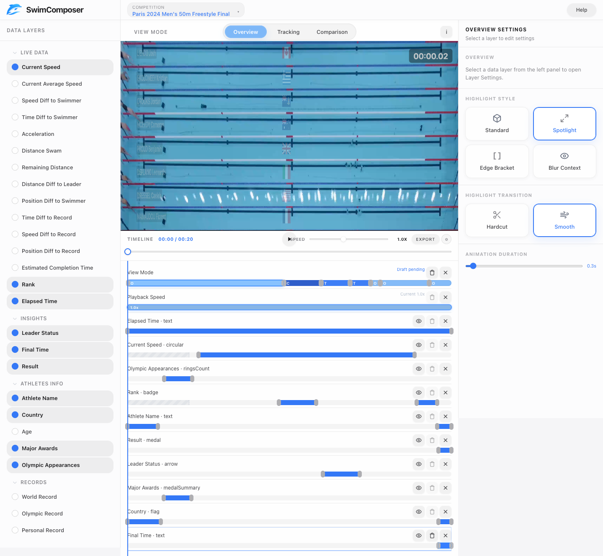

<h1 align="center">
  <br>
  SwimComposer
</h1>

<h3 align="center">Authoring Narrative Visualization in Motion:<br>Visual Storytelling in Swimming Videos</h3>

<p align="center">
  <strong>Junhao Zhao</strong> · Romain Vuillemot · Petra Isenberg · Lijie Yao<br>
  <em>IEEE Transactions on Visualization and Computer Graphics · IEEE VIS 2026</em>
</p>

<p align="center">
  <a href="https://arxiv.org/abs/2607.14924"><strong>Paper</strong></a> ·
  <a href="http://43.163.231.237"><strong>Online System</strong></a> ·
  <a href="#quick-start"><strong>Reproduce</strong></a> ·
  <a href="#citation"><strong>Citation</strong></a>
</p>

<p align="center">
  
  
  <a href="LICENSE"></a>
  <a href="https://www.replicabilitystamp.org/#https-github-com-nemozjh-swimcomposer" title="GRSI Replicability Stamp awarded"></a>
</p>

<p align="center">
  <br>
  <em>Video authoring, data-driven overlays, and a multi-track narrative timeline in one interface.</em>
</p>

## Overview

**SwimComposer** is an interactive authoring system for creating narrative visualizations in swimming videos. It lets authors connect prepared race data with video, compose explanatory overlays, and arrange narrative elements along a timeline.

| Data-aware authoring | In-context composition | Narrative timeline |
| --- | --- | --- |
| Bind race metrics and swimmer identities to visual explanations. | Place annotations and transitions directly over swimming footage. | Coordinate highlights, comparisons, camera behavior, and timing. |

## Quick Start

Clone the repository and enter its root directory:

```bash
git clone https://github.com/nemozjh/SwimComposer.git
cd SwimComposer
```

### Explore the interactive system

With Python 3.10 or newer installed, run:

```bash
python3 scripts/serve_swimcomposer.py
```

The script starts a local server and attempts to open your default browser. **If no browser window appears, keep the terminal running and open the URL printed after `Open:` yourself.** The default address is <http://127.0.0.1:8000/>; if port 8000 is occupied, the script chooses a free port and prints that address instead. Press `Ctrl+C` to stop the server.

On Windows, if Python is available through the Python launcher, use:

```powershell
py -3 scripts/serve_swimcomposer.py
```

Alternatively, serve the application directly from the repository root:

```bash
python3 -m http.server 8000 --bind 127.0.0.1 --directory swimcomposer_sourcecode
```

Then open <http://127.0.0.1:8000/> manually. On Windows, replace `python3` with `py -3` if needed.

### Run the automated reproduction

Requirements:

- Python 3.10 or newer, including the standard `venv` module.
- Internet access on the first run to download Playwright and its Chromium runtime.
- The automated reproduction was verified on macOS 26.4.1 with Playwright 1.61.0 and its pinned Chromium runtime on July 30, 2026. Other operating systems have not been verified for this workflow.

From the repository root, run:

```bash
./reproduce.sh
```

> **Headless by design:** this command does not open a visible browser window. It starts its own local server, runs Chromium in the background, saves the verification artifacts, and exits. To explore the interface, use the interactive command above.

The script validates the package, installs the pinned dependency into an isolated `.grsi-venv` directory, and follows the real playback path into the recorded Tracking segment between 12 and 14 seconds. It then pauses and writes:

- `output/playwright/representative_result.png` — the reproduced visual result.
- `output/playwright/reproduction_report.json` — the checked competition, timeline state, canvas count, screenshot dimensions and hash, and browser error summary.

These files are generated after running the script. Successful completion prints both paths and exits with status 0. Missing assets, browser errors, failed requests, a non-advancing video, or a missing rendered canvas cause a nonzero exit status.

No API keys, model downloads, external data services, or GPU are required for this system reproduction. The repository includes a compact demo video, prepared race data, and an authoring preset.

## Repository Structure

```text
SwimComposer/
├── docs/assets/                  # README logo, stamp, and interface image
├── swimcomposer_sourcecode/      # Interactive system and bundled demo
├── data_pipeline_sourcecode/     # Optional data-processing pipeline
├── scripts/
│   ├── check_package.py
│   ├── reproduce_result.py
│   └── serve_swimcomposer.py
├── output/playwright/            # Generated reproduction artifacts
├── requirements-reproduce.txt
├── setup.sh
├── reproduce.sh
├── LICENSE
├── NOTICE.txt
└── README.md
```

<details>
<summary><strong>Data-processing pipeline and reproduction scope</strong></summary>

The representative reproduction evaluates the interactive SwimComposer system using the bundled, precomputed demo data. It does not require running the full data-processing pipeline.

Executable source code and documentation for the pipeline are included in [`data_pipeline_sourcecode/`](data_pipeline_sourcecode/). They cover:

- Official swimming metadata collection.
- Video lane partitioning, swimmer tracking, trajectory cleaning, and overlay generation.
- Audio transcription, athlete-name normalization, and insight extraction.
- Fixed LLM prompts, JSON schemas, taxonomy, and output validation.

Some pipeline stages require additional software, model weights, an OpenAI-compatible API, and suitable compute hardware. The pipeline is not a one-command reproduction workflow. Precomputed outputs used by the interactive demo are included in [`swimcomposer_sourcecode/assets/competitions/swimming_competition2/`](swimcomposer_sourcecode/assets/competitions/swimming_competition2/).

</details>

## Citation

```bibtex
@article{Zhao:2027:SwimComposer,
  AUTHOR = {Junhao Zhao and Romain Vuillemot and Petra Isenberg and Lijie Yao},
  TITLE = {{Authoring Narrative Visualization in Motion: Visual Storytelling in Swimming Videos}},
  JOURNAL = {{IEEE Transactions on Visualization and Computer Graphics}},
  YEAR = {2027},
  NOTE = {In press}
}
```

## License

The original SwimComposer source code is released under the [MIT License](LICENSE). The bundled demonstration video and visual assets are included with authorization for distribution in this research-software and replicability package. Third-party components and separately authorized media remain subject to their respective terms; see [NOTICE.txt](NOTICE.txt).
