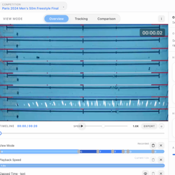

# SwimComposer



This repository contains the source code and reproducibility materials for
*SwimComposer*, the system presented in:

> Junhao Zhao, Romain Vuillemot, Petra Isenberg, and Lijie Yao.
>
> **Authoring Narrative Visualization in Motion: Visual Storytelling in
> Swimming Videos.**
>
> IEEE Transactions on Visualization and Computer Graphics (IEEE VIS 2026).

SwimComposer is an interactive authoring environment for creating narrative
visualizations in swimming-race videos. It combines prepared race data,
narrative views, visual layers, and temporal composition in a
frame-synchronous video authoring interface.

## Replicate the Interactive System

### Requirements

- Python 3.8 or newer
- A current desktop browser with JavaScript and WebGL support
- macOS or Linux

The package was verified on macOS 26.4.1 with Chromium on July 30, 2026.

No Python packages, API keys, model downloads, network services, or GPU are
required for the representative reproduction. The repository includes a
compact demo video, prepared race data, and an authoring preset.

### One-command reproduction

From the repository root, run:

```bash
./reproduce.sh
```

The script validates the package, starts a local HTTP server, and opens
SwimComposer in the default browser. The expected result is:

1. the page title is **SwimComposer**;
2. the competition selector shows **Paris 2024 Men's 50m Freestyle Final**;
3. the swimming video and the preconfigured visualization layers are visible;
4. pressing **Play** advances the video and the frame-synchronous
   visualizations.

Keep the terminal open while using the system. Press `Ctrl+C` in the terminal
to stop the local server.

### Manual fallback

If the browser does not open automatically:

```bash
cd swimcomposer_sourcecode
python3 -m http.server 8000
```

Then visit <http://127.0.0.1:8000/>.

## Reproduction Scope

The representative reproduction evaluates the interactive SwimComposer
system using the bundled, precomputed demo data. This is the shortest
reviewer-facing path and does not depend on paid APIs, special hardware, or
long-running machine-learning jobs.

The source code for the full multimodal data preparation pipeline is included
in [`data_pipeline_sourcecode/`](./data_pipeline_sourcecode/). It covers:

- official swimming metadata collection;
- video lane partitioning, swimmer tracking, trajectory cleaning, and overlay
  generation;
- audio transcription, athlete-name normalization, and insight extraction;
- fixed LLM prompts, JSON schemas, taxonomy, and output validation.

Running the full pipeline is optional for the representative reproduction.
Some stages require additional software, model weights, an OpenAI-compatible
API, and suitable compute hardware. Precomputed outputs used by the
interactive demo are included in
[`swimcomposer_sourcecode/assets/competitions/swimming_competition2/`](./swimcomposer_sourcecode/assets/competitions/swimming_competition2/).

## Repository Layout

```text
.
├── README.md
├── LICENSE
├── NOTICE.txt
├── SUBMISSION.txt
├── setup.sh
├── reproduce.sh
├── scripts/
│   ├── check_package.py
│   └── serve_swimcomposer.py
├── swimcomposer_sourcecode/       # interactive system and bundled demo
└── data_pipeline_sourcecode/      # optional pipeline, including LLM materials
```

The ZIP archives in the supplementary-material directory mirror the source
folders used for paper submission. They are not needed in a Git clone and are
ignored when this directory is initialized as a standalone repository.
Legacy duplicate copies of the LLM and official-metadata materials are also
ignored; their authoritative versions are under `data_pipeline_sourcecode/`.

## Data and Asset Authorization

The authors confirm that the bundled demonstration video and visual assets are
included with authorization for distribution in this research-software and
replicability package. See [`NOTICE.txt`](./NOTICE.txt) for the distinction
between the MIT-licensed original source code and third-party or separately
authorized material.

## License

The original SwimComposer source code is released under the
[MIT License](./LICENSE). Third-party components and separately authorized
media remain subject to their respective terms, as described in
[`NOTICE.txt`](./NOTICE.txt).
